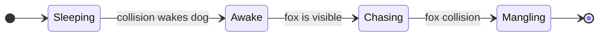

<!-- The Singularity Workshop moniker -->
<p align="center">
  <a href="https://github.com/TrentBest">
    
  </a>
</p>

<p align="center">
  <strong>Small simulations. Real state machines. Observable behavior.</strong><br/>
  <a href="https://github.com/TrentBest/FSM_API">FSM_API</a> ·
  <a href="https://www.nuget.org/packages/TheSingularityWorkshop.FSM_API/">NuGet</a> ·
  <a href="https://github.com/TrentBest">The Singularity Workshop</a>
</p>

---

# SimpleDemos: The Fox, the Dog, and the FSM

A small C#/.NET playground for learning how finite state machines (FSMs) coordinate behavior. Start with one fox and one sleeping dog, then explore a larger 2D fox-and-dog simulation and a separate throughput stress-test project.

**The point is not to animate a fox. The point is to make behavior explicit:** agents have state, conditions trigger transitions, and state callbacks determine what happens next.

## 00 · The problem

A fox walks toward a goal. A dog is asleep in its path. The fox can see obstacles, jump, collide, or flee; the dog can wake, chase, and catch the fox. The outcome depends on what each agent can observe and which transition conditions become true.

Without an explicit model, this behavior can quickly become a tangle of nested `if` statements. Here, each agent's behavior is organized into named states and transitions.

## 01 · What this demonstrates

- **FSM definitions:** build named states, transition conditions, and enter/update/exit callbacks.
- **Context-driven behavior:** each FSM operates on an ordinary C# context implementing `IStateContext`.
- **Multiple instances:** the same named FSM definition can control individual agents.
- **Processing groups:** the demo separates application-level work from agent updates.
- **Interaction between FSMs:** when the dog catches the fox, the dog's behavior requests a transition on the fox's FSM.
- **A larger simulation:** the repository also contains an advanced 2D simulation implementation with multiple foxes and dogs.
- **A separate stress-test project:** explores high-volume FSM update throughput. This is a workload experiment, not a portable benchmark result.

## 02 · Why FSM_API?

FSM_API separates *what state an agent is in* from *the data describing that agent*. The fox does not need to know how the application loop is implemented; it defines behavior and exposes context. The application coordinates sensing and updates.

That makes the behavior inspectable and easier to extend: add a state, define a transition, and implement the callbacks without rewriting the entire simulation loop.

## 03 · How the agents behave

### 🦊 The quick brown fox

<svg xmlns="http://www.w3.org/2000/svg" width="100%" viewBox="0 0 720 142" role="img" aria-label="Fox FSM: Walking can transition to Jumping and back to Walking, or transition to Fleeing when a collision occurs. The dog can force the fox into Mangled.">
  <defs>
    <marker id="fox-arrow" markerWidth="8" markerHeight="8" refX="6" refY="3" orient="auto"><path d="M0,0 L6,3 L0,6 Z" fill="#B45309"/></marker>
  </defs>
  <rect x="8" y="35" width="120" height="46" rx="8" fill="#FEF3C7" stroke="#B45309" stroke-width="2"/>
  <text x="68" y="63" text-anchor="middle" font-family="sans-serif" font-size="14" font-weight="700" fill="#78350F">Walking</text>
  <rect x="205" y="35" width="120" height="46" rx="8" fill="#FFEDD5" stroke="#B45309" stroke-width="2"/>
  <text x="265" y="63" text-anchor="middle" font-family="sans-serif" font-size="14" font-weight="700" fill="#9A3412">Jumping</text>
  <rect x="402" y="35" width="120" height="46" rx="8" fill="#FEE2E2" stroke="#B91C1C" stroke-width="2"/>
  <text x="462" y="63" text-anchor="middle" font-family="sans-serif" font-size="14" font-weight="700" fill="#991B1B">Fleeing</text>
  <rect x="592" y="35" width="120" height="46" rx="8" fill="#E5E7EB" stroke="#4B5563" stroke-width="2"/>
  <text x="652" y="63" text-anchor="middle" font-family="sans-serif" font-size="14" font-weight="700" fill="#1F2937">Mangled*</text>
  <path d="M128 48 H198" stroke="#B45309" stroke-width="2" marker-end="url(#fox-arrow)"/>
  <text x="163" y="27" text-anchor="middle" font-family="sans-serif" font-size="10" fill="currentColor">obstacle</text>
  <path d="M205 72 H135" stroke="#B45309" stroke-width="2" marker-end="url(#fox-arrow)"/>
  <text x="170" y="100" text-anchor="middle" font-family="sans-serif" font-size="10" fill="currentColor">jump complete</text>
  <path d="M128 81 C190 130 345 130 402 81" fill="none" stroke="#B91C1C" stroke-width="2" marker-end="url(#fox-arrow)"/>
  <text x="265" y="127" text-anchor="middle" font-family="sans-serif" font-size="10" fill="currentColor">collision → flee</text>
  <path d="M522 58 H585" stroke="#4B5563" stroke-width="2" stroke-dasharray="4 3" marker-end="url(#fox-arrow)"/>
  <text x="553" y="27" text-anchor="middle" font-family="sans-serif" font-size="10" fill="currentColor">dog forces</text>
  <text x="8" y="15" font-family="sans-serif" font-size="11" fill="currentColor">* Mangled is an externally requested state; the basic fox definition does not declare a normal transition into it.</text>
</svg>

The basic fox definition includes `Walking`, `Jumping`, `Fleeing`, and `Mangled`. It jumps when an obstacle is close, returns to walking when its jump completes, and flees after a dog collision. The dog can directly request the fox's `Mangled` state.

### 🐕 The lazy sleeping dog



The dog starts asleep. A collision wakes it; seeing the fox allows it to chase; a collision while chasing triggers its mangling behavior and requests the fox's `Mangled` state.

### 🦊🐕 Many agents, shared environment

The advanced source files extend the same idea into a 100 × 100 2D environment with multiple foxes and dogs, destinations, visibility, and collision checks. These files are an advanced implementation to explore; **the current console entry point launches the basic demo and optional stress test, not the advanced simulation**. That distinction is intentional here so the documentation does not claim an execution path that the current entry point does not provide.

## 04 · See it in a minute

### Requirements

- .NET 8 SDK
- Internet access on first restore, to retrieve the published FSM_API NuGet package

### Run the fox-and-dog demo

From the repository root:

```bash
dotnet run --project QuickBrownFox/QuickBrownFox.csproj
```

Watch the console output as the fox walks, detects the dog, jumps, and updates its position. The dog reacts to the shared environment's visibility and collision results. The demo ends when the fox reaches its goal, is mangled, or a key is available to stop the run.

When prompted, press **Y** to start the separate throughput stress test; press any other key to skip it. The stress test can create tens of thousands of FSM instances and may run for a while, so skip it for the first tour.

### Restore and build the solution

```bash
dotnet restore SimpleDemos.slnx
dotnet build SimpleDemos.slnx --no-restore
```

The stress test writes `benchmark_data.csv` and `article_table.txt` into its working directory. Results depend on the machine, runtime, and workload; do not treat one run as a universal performance claim.

## 05 · Read the code

| Start here | What to look for |
| :--- | :--- |
| [`Program.cs`](QuickBrownFox/Program.cs) | Application loop and optional stress-test prompt |
| [`SimpleDemoContext.cs`](QuickBrownFox/SimpleDemoContext.cs) | Environment sensing, processing groups, and shutdown |
| [`QuickBrownFox.cs`](QuickBrownFox/QuickBrownFox.cs) | Fox states, callbacks, and transition conditions |
| [`LazySleepingDog.cs`](QuickBrownFox/LazySleepingDog.cs) | Dog states and cross-FSM transition request |
| [`AdvancedDemoContext.cs`](QuickBrownFox/AdvancedDemoContext.cs) | Advanced multi-agent simulation setup |
| [`AdvancedDemoEnvironment.cs`](QuickBrownFox/AdvancedDemoEnvironment.cs) | Shared environment and agent sensing |
| [`Stress/Stress.cs`](Stress/Stress.cs) | Stress-test worker context and update workload |

### The pattern in miniature

An FSM definition describes behavior once; each instance supplies its own context:

```csharp
FSM_API.Create.CreateFiniteStateMachine("QuickBrownFoxFSM", -1, "Update")
    .State("Walking", OnEnterWalking, OnUpdateWalking, OnExitWalking)
    .State("Jumping", OnEnterJump, OnUpdateJumping, OnExitJumping)
    .State("Fleeing", OnEnterFleeing, OnUpdateFleeing, OnExitFleeing)
    .Transition("Walking", "Jumping", ShouldJump)
    .Transition("Jumping", "Walking", ShouldLand)
    .Transition("Walking", "Fleeing", ShouldFlee)
    .BuildDefinition();
```

This is an excerpt of the pattern in the source, not a standalone program: the callbacks and predicates are methods on the fox context. Read the full implementation for the data each condition inspects.

## Documentation and theory

- [FSM_API repository](https://github.com/TrentBest/FSM_API) — source, guides, and tests
- [FSM_API on NuGet](https://www.nuget.org/packages/TheSingularityWorkshop.FSM_API/) — install the package
- [FSM builder deep dive](https://github.com/TrentBest/FSM_API/blob/development/Documentation/User%20Guide/04_FSM_Builder_Deep_Dive.md) — states, transitions, and construction
- [The Singularity Workshop](https://github.com/TrentBest) — related projects and experiments

---

<p align="center">
  <strong>Understand the behavior. Inspect the state. Change the system.</strong><br/>
  <a href="https://github.com/TrentBest">The Singularity Workshop</a>
</p>
